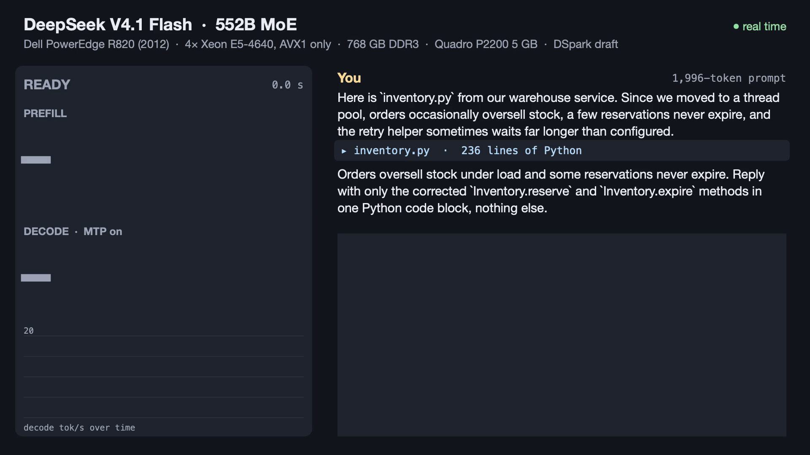
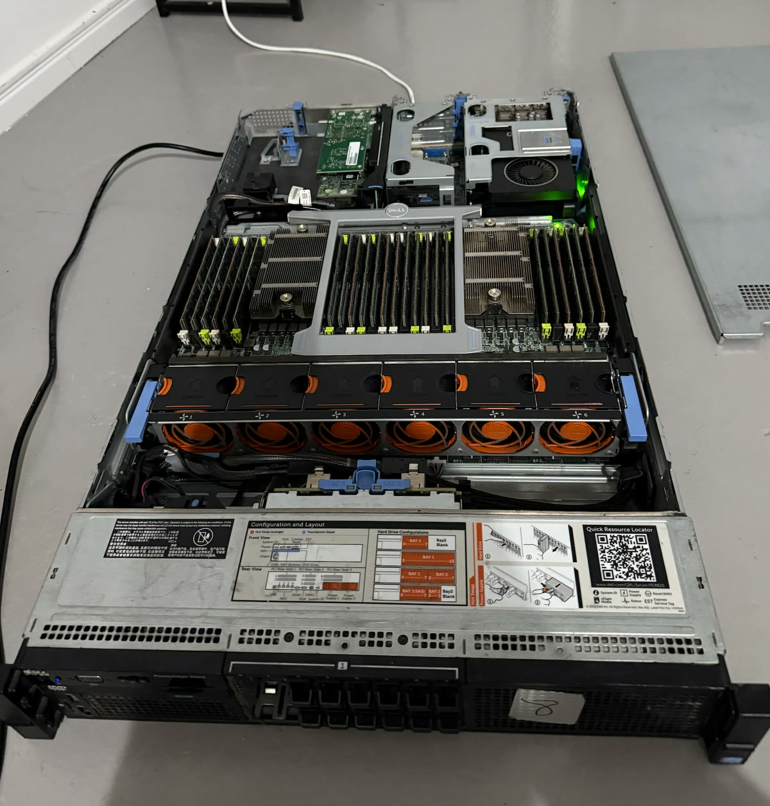

# r820-llm

Real time: a 1,996-token prompt at 99 tok/s, then decode at 11.9 tok/s with the MTP draft ([MP4](media/r820-deepseek-demo.mp4?raw=true)).

DeepSeek V4.1 Flash (552B MoE) on a 2012 Dell PowerEdge R820, with no new parts.

- 4 × Xeon E5-4640 (Sandy Bridge: AVX only, no AVX2, FMA or F16C), 64 threads, 4 NUMA nodes.
- 768 GB DDR3-1333 (48 × 16 GB).
- Quadro P2200 (Pascal, 5 GB).
- Model: Unsloth's UD-Q8_K_XL with the BF16 dense weights requantised to Q6_K. The experts stay MXFP4. It runs from a RAM disk.
- Engine: [ik_llama.cpp](https://github.com/ikawrakow/ik_llama.cpp) at `bdebfb6a` with `ik_llama/r820.patch`: an AVX1 port, native 128-bit kernels, a NUMA-local engine, and the GPU taking half of every dense matmul in decode and most of the prompt work.

**Decode 9.95 tok/s, prefill 101 tok/s.** With the model's MTP draft (DSpark), code decodes at 12–13 tok/s.

Build with `scripts/build-cuda.sh`, make the Q6_K model on the RAM disk with `scripts/make-dq6k.sh`, serve with `tools/serve-best.sh`.

## Decode

`llama-bench` tg32, 64 threads. Each row adds one change to the row above.

| Change | tok/s |
|---|---|
| Stock llama.cpp, model as downloaded (BF16 dense) | 0.43 |
| Dense weights BF16 → Q8_0 | 1.22 |
| Server power limits removed | 1.58 |
| ik_llama.cpp ported to AVX1 | 2.60 |
| NUMA-local engine: threads pinned per node, each weight's row quarters on their node | 3.27 |
| Native 128-bit matmul kernels | 3.90 |
| Two-level NUMA barrier, even split for small matmuls | 5.08 |
| NUMA-local output projection, Engram projections placed | 5.66 |
| Exact fp16 without F16C, decode flash attention for the shared K/V head, split norms | 5.94 |
| Dense weights Q8_0 → Q6_K with its own kernel | 6.52 |
| Lazy K/V concat, small ops over all threads | 6.68 |
| Half the rows of every dense matmul on the GPU (persistent kernel polling pinned memory) | 7.80 |
| Shared expert on the GPU beside the routed experts | 8.29 |
| Allocator plans kept per graph shape, router in Q8_0 | 8.87 |
| Activations quantised straight into the GPU's pinned buffer | 9.04 |
| Rope tables per thread, one-row ops over all threads | 9.41 |
| One decode graph shape reused every token; the expert router and hyper-connection steps as one node each | 9.82 |
| **Attention masks built once per graph, tiny nodes on one thread behind one barrier, the MoE output add fused, fp16 rows with SSE4.1** | **9.95** |

## Prefill

Each row adds one change to the row above.

| Change | Test | tok/s |
|---|---|---|
| Stock llama.cpp, model as downloaded | 7-token prompt | 4.2 |
| ik_llama.cpp, NUMA-local engine, CPU only | pp512 | 10.6 |
| Batched AVX1 kernels for the MXFP4 experts and Q6_K dense | pp512 | 23.9 |
| CUDA build: large batches on the GPU | pp512 | 26.1 |
| Prompt attention on the GPU, dense weights pinned for uploads | pp512 | 35.1 |
| Attention as gathered GEMMs (each query chunk reads only the K/V rows it can see) | pp512 | 41.9 |
| The busiest experts of each batch on the GPU while the CPU does the rest | pp512 | 62.7 |
| Experts' GPU output kept on the device, pinned buffers on the GPU's node | wikitext, 3 × 2048 | 73.8 |
| Next layer's likely experts uploaded during attention, attention weights staged | wikitext | 81.0 |
| 2048-token batches, faster row copies | wikitext | 85.6 |
| dp4a GPU matmul kernels for MXFP4 and Q6_K | wikitext | 94.0 |
| **Prompt attention on dp4a** | wikitext | **101.2** |

## What didn't work

- **512 GB at 1600 MT/s in place of 768 GB at 1333.** Minimal gains: +2–4% decode, prompts unchanged.
- **Dense layers on the GPU through ggml's scheduler.** Each CPU↔GPU hand-off costs 100–165 µs: 13–19% slower.
- **More than half of each dense matmul on the GPU.** The P2200's Q6_K kernel reads at ~115 of ~200 GB/s.
- **Faster MXFP4 expert kernels.** The experts already stream at the memory ceiling.
- **Other ways of moving activations between sockets** (split or per-socket quantisation, node-local copies). No gain.
- **Small ops on one socket, a barrier without shared counters.** ~3.6 µs per barrier is the floor on four sockets.
- **Prefetching the next matmul's weights into L3.** 4% slower.
- **A VRAM expert cache.** It would serve ~17% of expert reads.
- **Fewer threads,** for the experts or overall. Slower.
- **Prefill: prefetching the next GPU split, a larger GPU expert ring.** Nothing to hide the prefetch behind; the expert phase is CPU-bound.
- **The draft on the GPU.** 10% slower than on the CPU.
- **Draft-free speculation.** Gains only where the output repeats the prompt.
- **4-bit dense weights, 5 of 6 experts (`-ser`).** +5–11%, but KLD 0.07–0.15 against 0.018.

## The server

